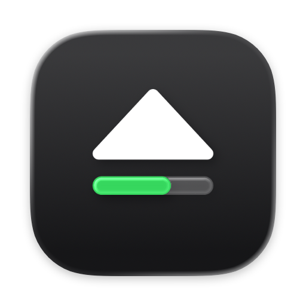
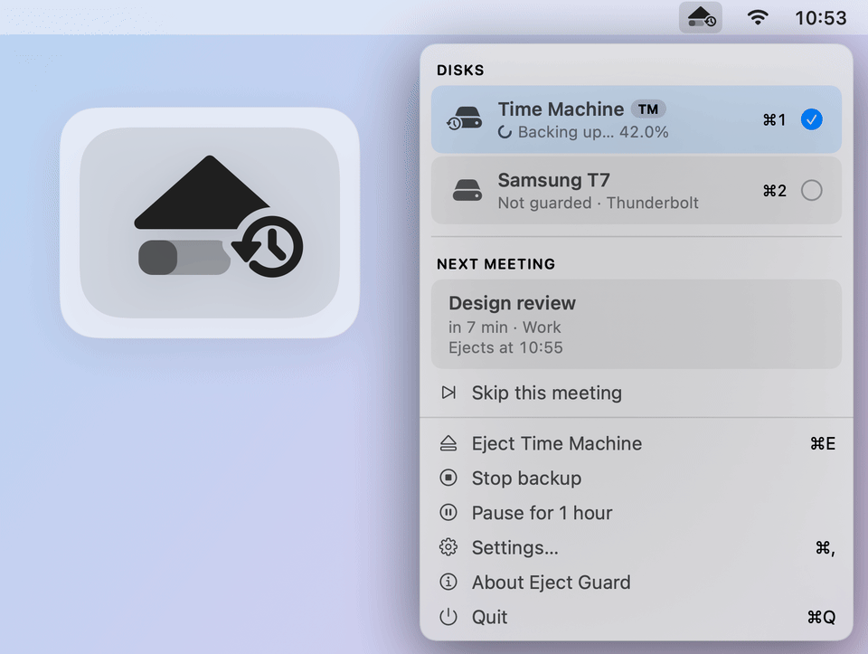
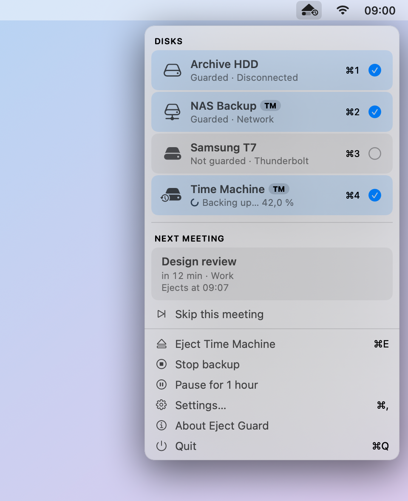

<p align="center"></p>

<h1 align="center">Eject Guard</h1>

<p align="center"><strong>Never unplug a mounted disk again.</strong></p>

<p align="center">
  <picture>
    <source media="(prefers-color-scheme: dark)" srcset="docs/hero-dark.gif">
    
  </picture>
</p>

Eject Guard is a small macOS menu bar app that unmounts your external disks a
few minutes before a meeting starts, so you can grab the laptop and go. Stay at
your desk instead, and it puts them back when the meeting ends. A Time Machine
drive, an archive, a portable SSD: whichever you tick.

You head to a meeting, pull the laptop off the desk, and only remember the
Time Machine drive once the cable is already out. On a spinning HDD, especially
mid-backup, that is how backups get corrupted. Eject Guard remembers for you.

## What it does

- **Unmounts on time.** Five minutes before a real meeting (you choose the
  lead time), your guarded disks are unmounted, safe to unplug, and you get a
  notification.
- **Puts them back if you stayed.** Joined the call from your desk and never
  touched the cable? The disk is reconnected when the meeting ends and Time
  Machine carries on, so a meeting never costs you a backup.
- **Knows a meeting from a calendar block.** Only timed events with other
  attendees count, so `Focus` or `Lunch` never trigger it. Declined and
  cancelled events are ignored.
- **Takes care of Time Machine.** A running backup to that disk is stopped
  cleanly first. Backups to other destinations keep going.
- **Guards network backups too.** Tick a Time Machine destination on a NAS and
  a backup running to it is stopped before the meeting, so you never walk off
  the network mid-write. Nothing is ejected: there is no cable to pull. Plain
  network shares are not listed.
- **Shows what it is doing** in the menu bar icon: a solid bar while a disk
  is guarded, Time Machine's progress whenever it is backing up (to a
  plugged-in disk or a network share, guarded or not), and a dashed outline
  while a disk waits to come back after a meeting.
- **Stays out of your way.** Skip a single meeting, pause for an hour, eject
  now with ⌘E, or eject when the Mac goes to sleep.
- **Tells you when it cannot eject**, and names the app holding the disk, so
  you know not to pull the cable.

It works in English, Slovak, Czech and German, and updates itself.

## Install

1. Download `Eject-Guard-<version>.zip` from the
   [latest release](https://github.com/m-moravcik/eject-guard/releases/latest).
2. Unzip it and move **Eject Guard** to Applications.
3. Open it and allow Calendar access. If you guard an encrypted Time Machine
   disk, also turn on Eject Guard in System Settings > Privacy & Security >
   Full Disk Access.
4. Click the menu bar icon and tick the disks to guard.

Turn on **Launch at login** in Settings so it survives a restart. The app is
signed with an Apple Developer ID, notarized by Apple and requires macOS 14 or
newer.

## Using it

The menu bar popover shows your disks and today's next meeting:

<p align="center">
  <picture>
    <source media="(prefers-color-scheme: dark)" srcset="docs/popover-dark.png">
    
  </picture>
</p>

- **Click a disk** to guard it. Disks are remembered once you plug them in,
  and Time Machine destinations appear straight away. Each row says how the
  disk is connected: USB, Thunderbolt, SD card, or network. ⌘1 to ⌘9 toggle them
  from the keyboard. A disk you do not guard is forgotten 30 days after you
  unplug it, and listed again the next time you plug it in. Disk images are
  never listed, unless Time Machine backs up to one. Two disks with the same
  name show their size, or the start of their UUID, to tell them apart.
- **Right-click a disk** to hide it for good, or, while it is unplugged, to
  forget it until you plug it in again. A guarded disk asks first. On a Time
  Machine destination that is plugged in, or on a share, **Back up now**
  starts a backup to it straight away, guarded or not.
- **While a disk waits** to be reconnected after a meeting, its row says when
  it comes back.
- **Next meeting** shows what the guard will do and when it will eject.
  **Skip this meeting** leaves your disks alone for that one event.
- **Eject now**, **Pause** and **Settings** sit at the bottom. While Time
  Machine is backing up, **Stop backup** stops it, whichever disk it writes
  to, say when it slows the Mac down. Time Machine carries on at its next
  backup.

In Settings you can change the lead time, count any timed event as a meeting,
ignore events marked *Free*, limit it to specific calendars, and enable ejecting
on sleep.

## Safe by design

- Only external, ejectable disks you ticked are ever ejected or unmounted. The
  startup disk cannot be ejected by any code path. A backup to a disk you did
  not tick is stopped or started only when you ask.
- Disks are recognised by their volume UUID, not by name.
- Nothing leaves your Mac. The calendar is read locally, and the app talks to
  the network only to check for updates. There is no telemetry: to report a
  bug, Settings > Advanced > Copy diagnostics puts the app's state and recent
  log on the clipboard, without meeting titles or disk names, for you to paste.
- The log names your meetings, so it is readable by you alone.

Good to know: like Finder, it takes down the whole physical disk, including its
other volumes. Before a meeting the disk is unmounted but stays attached, which
is what lets it come back on its own; ⌘E and eject on sleep eject it fully. An
encrypted disk is locked again whenever it is unmounted. If macOS remembers its
password in your login keychain, the app unlocks it with that password, after
you allow it once when macOS asks. Otherwise, for a Time Machine disk, it asks
Time Machine to start a backup to bring it back. If the disk stays locked, you
get a notification to plug it in again. macOS unlocks an encrypted Time Machine
disk only for an app with Full Disk Access; without it the notification says
so, and clicking it opens that setting.

## Shortcuts

Eject Guard adds actions to the Shortcuts app: **Eject Guarded Disks**,
**Pause Eject Guard**, **Resume Eject Guard**, **Skip Next Meeting** and
**Stop Time Machine Backup**. Use them in a personal automation, for example at
6 pm on weekdays or when a Focus mode turns on, or ask Siri to "Pause Eject
Guard". The app decides nothing new: each action does what the matching menu
item does, and says why when it cannot.

## Command line

The app ships with a command line tool, `eject-guard`, for scripts and your
own triggers: eject at the end of the workday, from a Focus mode, a Stream Deck
button or a Shortcuts *Run Shell Script* action. To put it on your PATH, open
Settings > Advanced and click **Install…**; it links the tool into
`/usr/local/bin` and asks for your password once. To do it by hand:

```sh
sudo ln -s "/Applications/Eject Guard.app/Contents/Helpers/eject-guard" /usr/local/bin/eject-guard
```

While the app is running, the tool asks the app to act, so the popover shows
the change at once and only one pass ever runs. Without the app it acts on its
own.

```sh
eject-guard                     # disks, selection, next meeting (--json for scripts)
eject-guard --eject-now         # eject guarded disks now
eject-guard --pause 60          # pause the guard for an hour (--resume ends it)
eject-guard --skip-next         # leave the disks alone for today's next meeting
eject-guard --stop-backup       # stop the running Time Machine backup
eject-guard --watch "WD"        # guard a disk
eject-guard --dry-run           # show what a pass would do, unmounting nothing
eject-guard --help              # everything else
```

Settings live in `~/Library/Application Support/EjectGuard/config.json` and
the log in `~/Library/Logs/eject-guard.log`.

Eject Guard was called TM Eject Guard before 1.3. Updating keeps your
settings: they move to the new folder on first launch.

## Building from source

```sh
./install.sh     # build, install to /Applications, link the CLI into ~/.local/bin, launch
./uninstall.sh   # remove, keeping config and log
```

How it works inside, testing, and releasing: [DEVELOPMENT.md](DEVELOPMENT.md).

## Support

Eject Guard is free and open source. If it ever saved a backup for you,
you can [buy me a coffee](https://buymeacoffee.com/pexelo).

## License

[MIT](LICENSE)

Built by [Michal Moravčík](https://github.com/m-moravcik). [More projects](https://web.pexelo.com/portfolio).
